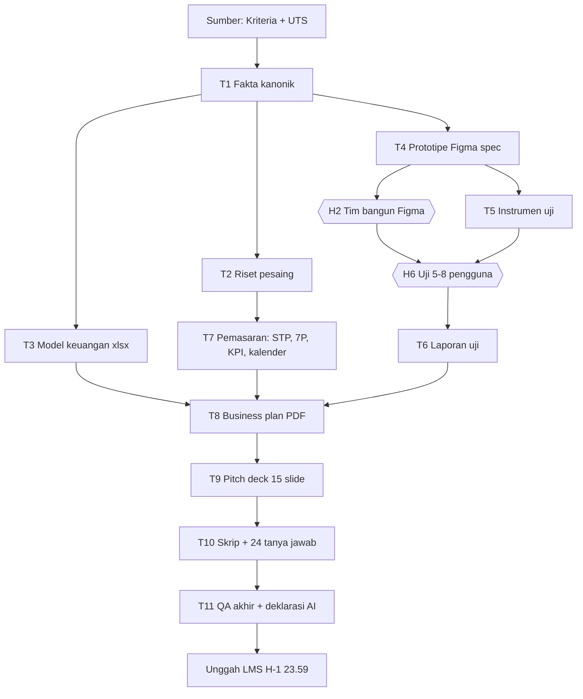
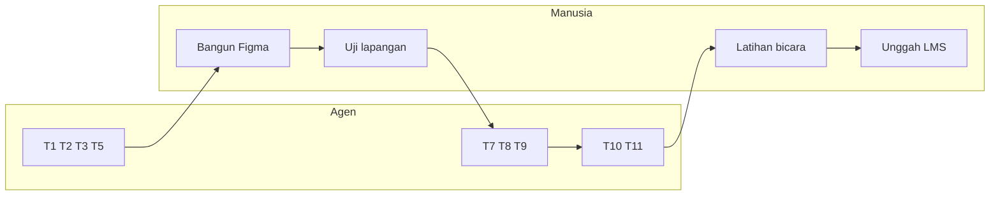
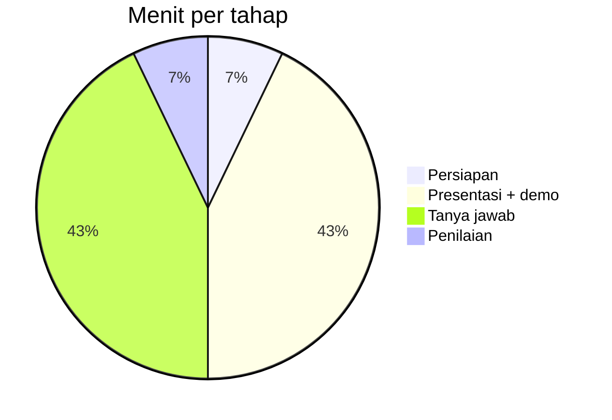

# Keputusan dan Rencana UAS Tumbuh.in

Hasil sesi "grilling" (skill `grilling` dari mattpocock/skills). Semua pertanyaan dijawab mandiri dengan jawaban rekomendasi. Ubah di sini bila tidak setuju, lalu sesuaikan `MASTER_BRIEF_UAS_TUMBUH-IN.md`.

## 1. Sumber kebenaran

| Peringkat | Sumber | Dipakai untuk |
|---|---|---|
| 1 | `Kriteria_UAS_...pdf` | Apa yang wajib dikumpulkan dan dinilai |
| 2 | `UTS_KWU-TI_Tim1_Tumbuh-in-AI FINAL.md` | Semua fakta produk, bukti, angka biaya |
| 3 | `Format_Laporan_Hasil_Pengujian_dan_Form_Pengujian.docx` | Bentuk laporan uji. Isinya contoh StokMudah, bukan data kita |
| 3 | `Salinan dari Format_Laporan_Keuangan_...xlsx` | Bentuk model keuangan. Angkanya contoh StokMudah |
| 4 | `UTS_...Pichdeck.pdf` | Gaya dan isi deck UTS (bukan struktur UAS) |

Dua sumber utama = peringkat 1 dan 2. Bila bentrok, peringkat kecil menang.

## 2. Pertanyaan dan keputusan

| # | Pertanyaan | Keputusan | Alasan |
|---|---|---|---|
| D1 | Produk apa? | Tumbuh.in: rekap harian dari foto nota/suara + penanda stok | UTS Bab 2. Jangan kembali ke "prediksi penjualan" (sudah terbantah di Bab 6) |
| D2 | Contoh StokMudah di template dipakai? | Tidak. Hanya bentuk | Angka Rp149.000, 12 responden, SUS 70,6 itu rekaan. Menyalin = pemalsuan |
| D3 | Bentuk prototipe? | Figma klik-tembus, 4 layar, data contoh. Tanpa AI sungguhan | Kriteria menerima tautan Figma. Waktu dan memori terbatas |
| D4 | Berapa penguji? | Target 8, batas bawah 5, dari segmen warung SWK Srikana | Kriteria: min 5. Template menyarankan 12, tapi segmen hanya 25 |
| D5 | Hasil uji? | Kosong sampai diuji sungguhan. Agen dilarang mengarang | Kriteria butir 4 dan etika akademik |
| D6 | Harga? | Langganan Rp24.000/bln (Alt 1) | Keputusan UTS Bab 4.4 |
| D7 | Biaya tetap? | Tahap hemat Rp171.000, tahap penuh Rp663.000 | UTS Bab 4.4 |
| D8 | CAC? | Pendampingan hari pertama Rp30.000 dipindah dari biaya variabel ke CAC | Template punya baris CAC. Hindari hitung ganda |
| D9 | Konsekuensi D8? | Variabel ±Rp7.068; margin ±Rp16.932; BEP ±11 (hemat), ±40 (penuh). Hitung ulang di xlsx | Beda dari UTS (12 dan 46). Catat di laporan sebagai koreksi |
| D10 | Dana awal? | Modal tim Rp6.000.000 (6 x Rp1.000.000), tanpa investor, tanpa honor | Realistis untuk mahasiswa. Label A |
| D11 | Pesaing? | Riset 4 sampai 5 pesaing nyata dengan sumber | UTS uji #2 belum membandingkan pesaing |
| D12 | Eksperimen UTS (Bab 5) kosong. Cukup? | Tidak. Jalankan A1 dan A2 sebelum UAS | Bab 1 deck UAS butuh "bukti validasi" |
| D13 | Kanal digital? | WhatsApp Business utama, Instagram/TikTok demo pendek sekunder | Segmen susah ponsel (R-02), kunjungan langsung (UTS) |
| D14 | Format file? | Laporan PDF, xlsx, deck PPTX, uji PDF | Kriteria Bagian 2 |
| D15 | Pakai AI? | Boleh. Deklarasikan di slide terakhir dan lampiran | Kriteria butir 3 |

## 3. Hal yang hanya manusia bisa jawab

| # | Butir | Kenapa |
|---|---|---|
| H1 | Tanggal UAS dan batas LMS | Tidak ada di file. Batas = H-1 pukul 23.59 WIB |
| H2 | Tautan Figma jadi | Harus dibuat dan dibagikan tim |
| H3 | Rubrik bobot nilai | PDF kriteria hanya 3 halaman; tabel bobot tidak ada |
| H4 | Ejaan nama anggota | UTS: "Alfiyan Rasyid El-Fahmi"; deck: "Alfian Rasyid El Fahmi" |
| H5 | Peran bicara 6 anggota | Semua wajib bicara dan dapat 2 pertanyaan |
| H6 | Data uji pengguna | Harus dikumpulkan di lapangan |

## 4. Alur kerja

## 5. Pembagian: agen vs manusia

## 6. Waktu presentasi (28 menit)

Demo prototipe 3 sampai 4 menit dari 12 menit. Sisa 8 menit untuk 8 bagian struktur presentasi.

## 7. Risiko

| Risiko | Penanganan |
|---|---|
| Angka uji dikarang agen | Aturan K1 di master brief; kolom hasil diisi `[BELUM DIUJI]` |
| Titik impas tahap penuh (±40) melebihi 25 pedagang | Jujur di laporan; klaim layak hanya tahap hemat; skenario optimis 58 |
| Foto/suara AI belum terbukti akurat | Demo pakai data contoh; sebut sebagai asumsi A4 |
| Contoh template tercampur ke laporan | Cek kata "StokMudah", "149.000", "Tim 3" sebelum kirim |
| Memori laptop rendah | Kerjakan tugas satu per satu, jangan paralel |
